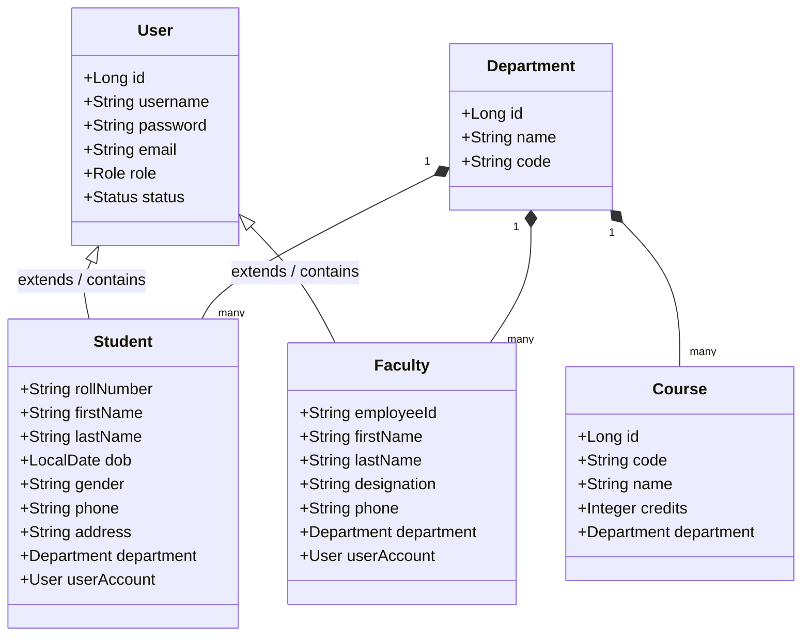
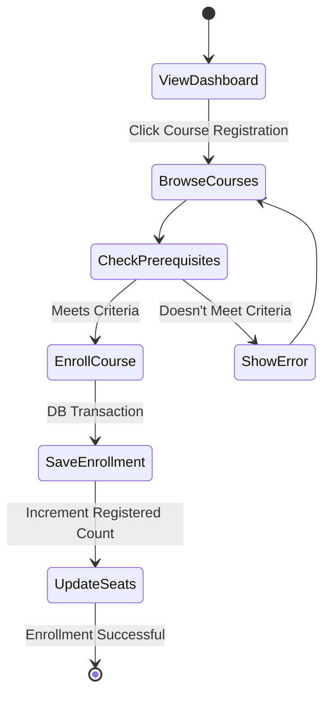
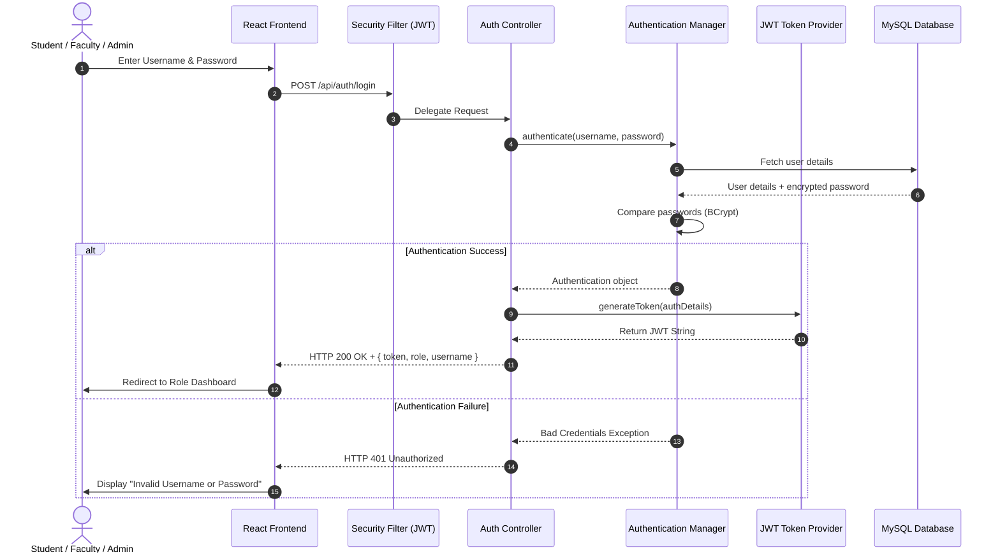

# Database & System Design Diagrams

This document contains Mermaid JS diagrams for the College Management System. You can copy these code blocks directly into your project report or view them inside any markdown editor that supports Mermaid rendering.

---

## 1. Entity-Relationship (ER) Diagram

Describes the relationships, primary keys, and foreign keys between all tables.

```mermaid
erDiagram
    DEPARTMENTS {
        int id PK
        varchar name UNIQUE
        varchar code UNIQUE
        text description
        timestamp created_at
    }
    USERS {
        int id PK
        varchar username UNIQUE
        varchar password
        varchar email UNIQUE
        varchar role
        varchar status
        timestamp created_at
        timestamp updated_at
    }
    STUDENTS {
        int id PK, FK
        varchar roll_number UNIQUE
        varchar first_name
        varchar last_name
        date date_of_birth
        varchar gender
        varchar phone
        text address
        date admission_date
        int department_id FK
        varchar profile_picture_url
    }
    FACULTY {
        int id PK, FK
        varchar employee_id UNIQUE
        varchar first_name
        varchar last_name
        varchar designation
        varchar phone
        text address
        date joining_date
        int department_id FK
        varchar profile_picture_url
    }
    COURSES {
        int id PK
        varchar code UNIQUE
        varchar name
        text description
        int credits
        int department_id FK
    }
    COURSE_FACULTY {
        int course_id PK, FK
        int faculty_id PK, FK
        int semester PK
        varchar academic_year PK
    }
    COURSE_ENROLLMENTS {
        int id PK
        int student_id FK
        int course_id FK
        date enrollment_date
        varchar status
    }
    ATTENDANCE {
        int id PK
        int student_id FK
        int course_id FK
        date date
        varchar status
        varchar remarks
    }
    MARKS {
        int id PK
        int student_id FK
        int course_id FK
        varchar exam_type
        decimal marks_obtained
        decimal max_marks
        varchar grade
    }
    HOSTELS {
        int id PK
        varchar name UNIQUE
        varchar type
        int capacity
        text address
    }
    HOSTEL_ROOMS {
        int id PK
        int hostel_id FK
        varchar room_number
        int capacity
        int occupancy
        decimal rent_per_semester
    }
    HOSTEL_ALLOCATIONS {
        int id PK
        int student_id FK
        int room_id FK
        date allocation_date
        date vacated_date
        varchar status
    }
    LIBRARY_BOOKS {
        int id PK
        varchar title
        varchar author
        varchar isbn UNIQUE
        varchar publisher
        int total_copies
        int available_copies
        varchar category
    }
    LIBRARY_ISSUES {
        int id PK
        int student_id FK
        int book_id FK
        date issue_date
        date due_date
        date return_date
        decimal fine_amount
        varchar status
    }
    PLACEMENTS {
        int id PK
        varchar company_name
        date drive_date
        varchar job_profile
        decimal package_lpa
        text eligibility_criteria
        varchar status
    }
    PLACEMENT_APPLICATIONS {
        int id PK
        int placement_id FK
        int student_id FK
        varchar status
        varchar round_reached
        timestamp applied_at
    }
    FEES_STRUCTURE {
        int id PK
        int department_id FK
        varchar academic_year
        int semester
        decimal tuition_fee
        decimal hostel_fee
        decimal library_fee
        decimal other_fees
    }
    STUDENT_FEES {
        int id PK
        int student_id FK
        int fee_structure_id FK
        decimal amount_paid
        decimal due_amount
        varchar payment_status
        date last_payment_date
    }
    NOTIFICATIONS {
        int id PK
        varchar title
        text message
        varchar target_role
        timestamp created_at
    }

    DEPARTMENTS ||--o{ STUDENTS : "belongs to"
    DEPARTMENTS ||--o{ FACULTY : "belongs to"
    DEPARTMENTS ||--o{ COURSES : "offers"
    USERS ||--o| STUDENTS : "is profile"
    USERS ||--o| FACULTY : "is profile"
    COURSES ||--o{ COURSE_FACULTY : "part of"
    FACULTY ||--o{ COURSE_FACULTY : "assigned to"
    STUDENTS ||--o{ COURSE_ENROLLMENTS : "registers"
    COURSES ||--o{ COURSE_ENROLLMENTS : "enrolled in"
    STUDENTS ||--o{ ATTENDANCE : "logged for"
    COURSES ||--o{ ATTENDANCE : "class of"
    STUDENTS ||--o{ MARKS : "graded for"
    COURSES ||--o{ MARKS : "marks of"
    HOSTELS ||--o{ HOSTEL_ROOMS : "contains"
    HOSTEL_ROOMS ||--o{ HOSTEL_ALLOCATIONS : "allocates"
    STUDENTS ||--o{ HOSTEL_ALLOCATIONS : "stays in"
    LIBRARY_BOOKS ||--o{ LIBRARY_ISSUES : "issued as"
    STUDENTS ||--o{ LIBRARY_ISSUES : "borrows"
    PLACEMENTS ||--o{ PLACEMENT_APPLICATIONS : "holds"
    STUDENTS ||--o{ PLACEMENT_APPLICATIONS : "applies"
    FEES_STRUCTURE ||--o{ STUDENT_FEES : "specifies"
    STUDENTS ||--o{ STUDENT_FEES : "bills"
```

---

## 2. Use Case Diagram

Illustrates how Admin, Faculty, and Student act on different system boundaries.

```mermaid
usecaseDiagram
    actor Admin
    actor Faculty
    actor Student

    rectangle "College Management System" {
        usecase "Manage Users & Roles" as UC1
        usecase "Manage Courses & Depts" as UC2
        usecase "Manage Fees & Structures" as UC3
        usecase "Mark/Upload Attendance" as UC4
        usecase "Upload Marks/Grades" as UC5
        usecase "View Personal Attendance" as UC6
        usecase "View Personal Marks" as UC7
        usecase "Enroll in Courses" as UC8
        usecase "Manage Hostel & Library" as UC9
        usecase "Apply for Placements" as UC10
        usecase "Receive Notifications" as UC11
    }

    Admin --> UC1
    Admin --> UC2
    Admin --> UC3
    Admin --> UC9
    
    Faculty --> UC4
    Faculty --> UC5
    Faculty --> UC11
    
    Student --> UC6
    Student --> UC7
    Student --> UC8
    Student --> UC10
    Student --> UC11
```

---

## 3. Class Diagram (Backend Architecture)

Represents the core packages and classes in the Spring Boot project.



---

## 4. Activity Diagram (Student Course Enrollment)

Illustrates the procedural flow of a student enrolling in an elective course.



---

## 5. Sequence Diagram (User Login & JWT Generation)

Details the precise system-level message passing during user authentication.


